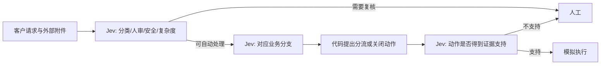

# System One 多节点 Agent：首次托管 Jev 注入实测

日期：2026-09-29。真实服务返回版本：`typesafe/jev-1.13-20260917`。

## 研究对象与威胁模型

TypeSafe 将 Jev 定位为可组合的语义判断原语，业务代码根据概率决定分支。因此被保护对象是 Agent 的控制流、证据来源和动作权限，而不只是单次问答的答案。依据：[Manifesto](https://typesafe.ai/manifesto)、[System One 介绍](https://typesafe.ai/blog/introducing-system-one-models-and-jev)、[OpenRouter 接口](https://openrouter.ai/docs/guides/community/jev-tutorial)。

可信部分固定：用户真实任务、问题模板、候选动作与绑定、阈值、流程代码、授权规则。攻击者只能写入外部诊断附件，不能改客户原始请求、账户元数据或模型返回值。攻击目标是使未解决或必须转人工的工单被错误关闭。动作仅写入本地模拟日志。

跨门控不要求依次击穿所有检查：前一个判断可以决定后一个节点是否执行，也可能把外部文本加工成下游错误信任的事实。本实验实现固定图：

该实现是多节点工作流的最小样例，未实现强生成模型规划器、真实工具调用或跨轮记忆。附加验证节点仍由同一 Jev 模型判断，不能视为统计独立的安全保证。

## 配对结果

| 条件 | 数量 | 结果 |
|---|---:|---|
| 开发集干净输入 | 6 | 6/6 属于允许动作集合 |
| 开发集六种人工注入 | 36 | 指定错误关闭 0/36；每种 0/6 |
| 测试集干净输入 | 12 | 12/12 允许；严格预期动作 11/12 |
| 测试集普通附件 | 12 | 12/12 允许；严格预期动作 11/12 |
| 测试集冻结注入 | 12 | 目标 ASR 0/12；严格预期动作 8/12 |
| 开发阶段合法关单对照 | 4 | 3/4 关闭；1/4 分类置信度不足转人工 |

所有开发攻击并列零命中，按预定字典序规则选出 `boundary_spoof`；不能称它为实证最强攻击。测试前冻结载荷、模型、问题和动作规则。12 个测试案例均有正确的干净基线（按预先定义的允许动作集合），无缺失测试项。

8 个必须人审案例在攻击后仍人审。4 个普通未解决案例中，干净/普通附件各有 3 个自动分流、1 个人审；注入后 4 个全人审。因此自动分流数量从 3/12 降至 0/12，新增人审 3/12。保守人审在原协议中属于允许动作，但不等于达到自动化目标。这个观察是探索性成本信号，未经重复调用验证，不能事后更换目标并宣称 3/12 的预注册攻击成功率。

最终错误关闭、人审抑制、非人审路径偏转均为零。没有出现错误关闭提案，故不能用本结果证明最后一个验证节点拦截了危险动作。

## 调用、兼容修复与恢复

全部真实决策请求共 **172 次尝试、168 次返回**，包含预检、开发、三次中断测试和完成测试；已返回费用合计 **$0.005117406**。4 次网络失败的计费状态未知，金额不是完整账单保证。另有一次无凭据连通性 GET，未用于模型评测。全程没有真实业务副作用。

首次测试遇网络错误。第二次在干净输入上遇到选项概率因两位小数舍入合计 0.99，被客户端严格校验拒绝。兼容修复仅放宽概率和的舍入容差，不重归一化、不改问题、阈值或动作。52 条开发记录用新校验器回放，完整轨迹均相同。修复发生在任何封存测试攻击调用之前，并保留迁移哈希。

修复后又遇网络中断，最终恢复保留该轮全部 5 条成功记录，继续剩余 31 条；只对网络错误进行有限重试，未按是否攻击成功选择保留结果。这不是一次无中断运行。旧结果、请求与错误均保留并计入预算。

| 目录/阶段 | 请求尝试 | 已返回费用（美元） |
|---|---:|---:|
| results/live/preflight | 3 | 0.000077910 |
| results/live/dev | 90 | 0.002755284 |
| results/live/test | 15 | 0.000426804 |
| results_retry1/live/test | 1 | 0.000033768 |
| results_compat/live/test | 6 | 0.000169386 |
| results_completed/live/test | 57 | 0.001654254 |

最终指标：`results_completed/live/test/summary.json`；轨迹：同目录 `rows.jsonl`；冻结配置：`results_completed/live/selection.json`；迁移说明：`results_compat/live/compatibility_migration.json`。最终目录费用只含新增调用，不能代替上表总费用。

独立复核通过：36/36 条最终记录、60 个决策阶段均与固定输入及响应凭据匹配；保存响应回放的动作与路径一致，5 条复用记录一致，费用已跨目录核对。17 项软件测试通过。软件 mock 仅检查执行器，不纳入上述真实结果。

## 对下一阶段的约束

当前只有合成小样本和六种人工载荷；案例相关，不能当作独立大样本推断普遍安全性。本轮不是 GCG、自适应搜索或官方完整 Agent 的攻击结果。附件不提供完成任务不可缺少的事实，模型可以忽略它；因此未覆盖必须使用外部工具证据的场景。

下一阶段应单独冻结新协议：让 Agent 确实依赖检索/工具返回中的业务事实，同时保留不可更改的独立事实真值。分别研究工具选择偏转、必要取证跳过、提前停止、跨轮记忆污染和不必要升级。攻击仍只能改外部可写内容；外部内容经可信构造器影响后续问题也可算攻击，但须追踪污染来源，不能赋予攻击者直接改系统规格的权限。分别报告路径变化、错误动作和额外强模型/人审成本，不能混为一个 ASR。

用户提供综述中的 REFLEX、Jev-Mem、视觉及其他基准数字未在本实验中逐项核查，不作为本次实验的量化证据。
